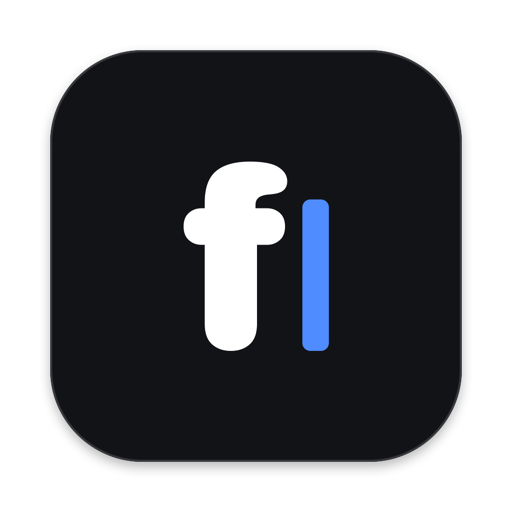

<p align="center"></p>

<h1 align="center">fdev</h1>
<p align="center">The frontend toolkit that lives in your Mac's menu bar.</p>

<p align="center"><a href="https://github.com/vishnugopy/fdev/releases/latest"><b>Download</b></a> · <a href="https://vishnugopy.github.io/fdev/">Website</a></p>

Pick a color from any window, name the font under your cursor, measure the screen, check contrast, write CSS and clean up images — from the menu bar, one shortcut each, or an action wheel. Native SwiftUI, everything on-device.

## Tools

| | Tool | Shortcut |
|---|---|---|
| Pick & inspect | **Pick Color** — any pixel, any display; HEX, RGB, HSL, P3, SwiftUI, CSS var | ⌥⌘C |
| | **Check Contrast** — WCAG 2.2 AA/AAA | |
| | **Detect Font** — family, weight, size, and whether it's on Google Fonts | ⌥⌘F |
| | **Measure Screen** — on-screen ruler | ⌥⌘M |
| CSS | **Convert px ↔ rem**, **Generate Fluid Type** (`clamp()`), **Build Box Shadow** (CSS, Tailwind, SwiftUI) | |
| Images | **Convert Image** (AVIF, JPEG, PNG, HEIC, data URI), **Remove Background** (Apple Vision + solid-color keying, batch) | |
| Code | **Transform Text & JSON** — format/minify/sort JSON, Base64, URL, naming cases | |

**Action wheel** — hold <kbd>⌥Space</kbd>, point at a tool, release.

Also: pin the menu open, drag images to the menu bar, keep your last screenshot at hand, Clean Keyboard mode, copy pop-up, iCloud Drive settings sync, launch at login.

## Requirements

macOS 26 or later. Detect Font and Clean Keyboard need Accessibility permission (System Settings → Privacy & Security → Accessibility).

## Build

```bash
./build.sh            # → build/fdev.app
scripts/release.sh    # sign with Developer ID, notarize, staple, build the DMG
```

`release.sh` expects a notarytool keychain profile named `fdev-notary`:

```bash
xcrun notarytool store-credentials fdev-notary --apple-id YOU@example.com --team-id YOURTEAMID
```
